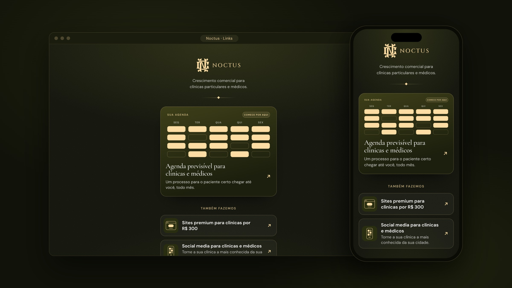

<h1 align="center">Noctus · Links</h1>

  Página de links da Noctus para a bio do Instagram. 
  Crescimento comercial para clínicas particulares e médicos.

  

  
  
  
  

## Os links

Um link principal em destaque e dois secundários, agrupados em "Também fazemos". Os três abrem o WhatsApp com uma mensagem pronta.

| | Link | Mensagem no WhatsApp |
|:-:|---|---|
| ★ | **Agenda previsível para clínicas e médicos** | Olá! Quero saber como ter uma agenda previsível na minha clínica. |
| 2 | Sites premium para clínicas por R$ 300 | Olá! Quero um site premium para a minha clínica. |
| 3 | Social media para clínicas e médicos | Olá! Quero social media para a minha clínica. |

## O que tem aqui

| Arquivo | O que é |
|---|---|
| `index.html` | A página inteira, com o CSS dentro e as ilustrações em SVG |
| `assets/` | As fontes DM Sans e Cormorant e o logo da Noctus |
| `favicon.svg`, `favicon.ico`, `apple-touch-icon.png` | Os ícones da aba e da tela inicial do celular |
| `vercel.json` | O cache dos arquivos e os cabeçalhos de segurança na Vercel |

## Como alterar

- **Destino de um link:** troque o `href` dele no `index.html`.
- **Mensagem do WhatsApp:** troque o texto depois de `?text=`, com os espaços escritos como `%20`.
- **Link de sites:** quando a página do site por R$ 300 estiver no ar, use o endereço dela no lugar do WhatsApp.

## Subir na Vercel

1. Na Vercel, clique em **Add New → Project** e importe este repositório.
2. Em **Framework Preset**, escolha **Other**. Deixe **Build Command** e **Output Directory** vazios.
3. Clique em **Deploy** e coloque o endereço na bio do Instagram.

## Detalhes

- Abre na hora, mesmo no 4G: são cerca de 45 KB, com as fontes e o logo incluídos.
- Não tem foto, rastreador nem cookie. A agenda e as miniaturas são desenhadas em SVG.
- Os itens entram na tela um depois do outro. Quando o aparelho pede menos movimento, a entrada vira um fade suave.
